<!-- animated contribution graph: real data, cells pop in left to right
     (refresh: python scripts/fetch_contributions.py && python scripts/render_heatmap_svg.py) -->

<h3><code>x0d4n@github ~ $ ./contributions.sh</code></h3>

 
 

<h3><code>x0d4n@github ~ $ ./links.sh</code></h3>

<b>Final-year student · Software developer · Cybersecurity enthusiast</b>

 

